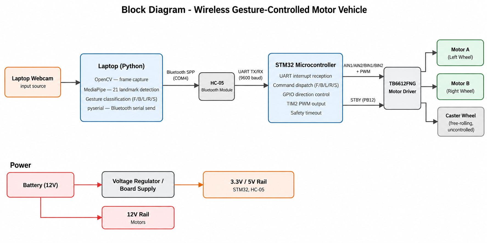
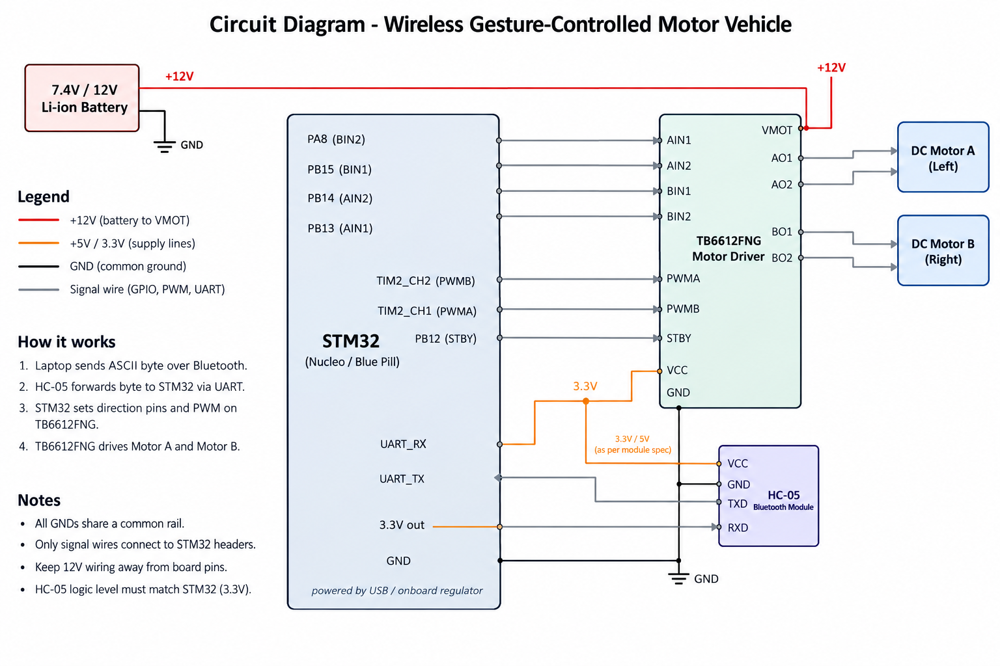
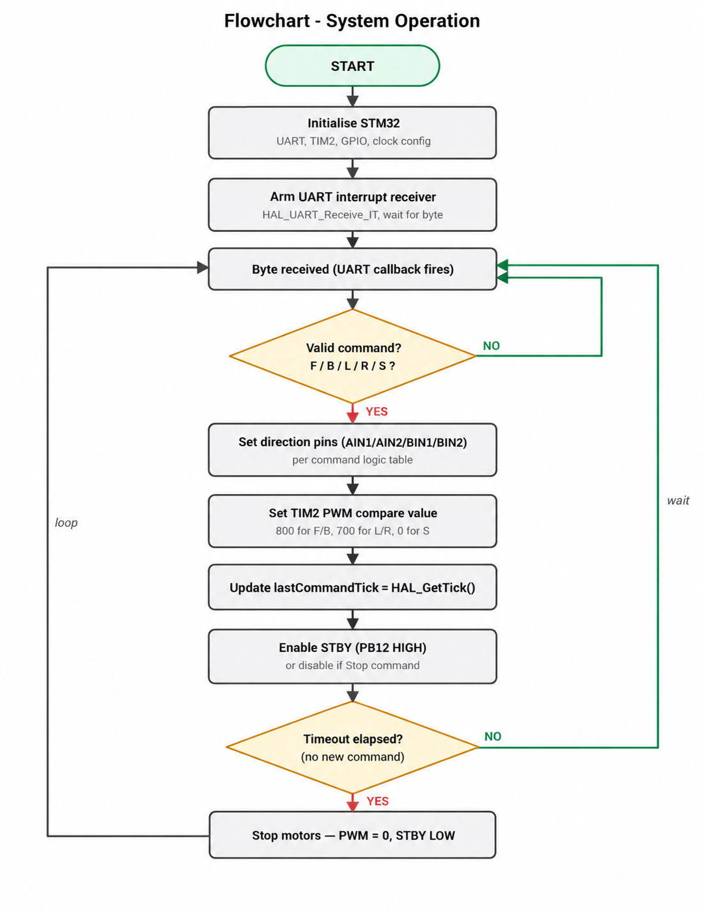

# Wireless Gesture-Controlled Motor Vehicle

A hand gesture-controlled robotic vehicle that uses computer vision, Bluetooth communication, and an STM32 microcontroller to enable wireless movement without a physical remote controller.

## Overview

The **Wireless Gesture-Controlled Motor Vehicle** is an embedded systems project that allows users to control a two-wheeled robotic vehicle using hand gestures captured through a laptop webcam.

The system uses **Python, OpenCV, and MediaPipe** to detect and classify hand gestures in real time. Recognized commands are transmitted wirelessly through an HC-05 Bluetooth module to an STM32 microcontroller, which controls the vehicle's DC motors using a TB6612FNG motor driver.

The project demonstrates the integration of computer vision, wireless communication, and microcontroller-based motor control into a single real-time system.

## Problem Statement

Conventional robotic vehicles typically rely on dedicated remote controllers, wired joysticks, or smartphone applications for movement. These approaches require additional hardware, restrict freedom of movement through cables, or involve interacting with physical or virtual buttons.

Gesture-based control offers a more natural and intuitive alternative. However, implementing such a system requires reliable gesture recognition, wireless command transmission, and accurate motor control.

The objective of this project is to develop a wireless robotic vehicle that recognizes natural hand gestures using a standard laptop webcam and translates them into real-time movement commands without requiring a dedicated handheld controller or sensor-equipped glove.

## Proposed Solution

The proposed system combines computer vision, Bluetooth communication, and embedded motor control to create a gesture-controlled robotic vehicle.

The laptop webcam captures the user's hand movements, while MediaPipe detects 21 hand landmarks. A Python program interprets the landmark positions and classifies gestures into five commands: forward, backward, left, right, and stop.

Each command is transmitted as a single ASCII character over Bluetooth Serial Port Profile (SPP) using an HC-05 module. The STM32 microcontroller receives these commands through UART and controls the TB6612FNG motor driver using GPIO direction signals and PWM speed control.

A safety timeout mechanism automatically stops the motors if new commands are not received within the configured time window.

## Features

* **Gesture-Based Control:** Control the vehicle using natural hand movements.
* **Real-Time Hand Detection:** Detect 21 hand landmarks using MediaPipe.
* **Five Motion Commands:** Move forward, backward, turn left, turn right, and stop.
* **Wireless Communication:** Transmit commands over Bluetooth using the HC-05 module.
* **Embedded Motor Control:** Use an STM32 microcontroller to process commands and control two DC motors.
* **PWM Speed Control:** Adjust motor speed through timer-generated PWM signals.
* **Safety Timeout:** Automatically stop the motors when commands stop arriving.
* **Controller-Free Operation:** No dedicated handheld remote or sensor-equipped glove is required.

## System Architecture

The system consists of three main layers.

### 1. Input Layer — Gesture Recognition

The laptop webcam captures video frames. OpenCV handles image capture and processing, while MediaPipe identifies 21 hand landmarks. A Python-based gesture classifier determines the intended movement and generates the corresponding command.

### 2. Communication Layer — Bluetooth and UART

The HC-05 Bluetooth module establishes a wireless serial connection with the laptop. It receives commands over Bluetooth SPP and forwards them to the STM32 microcontroller through UART at 9600 baud.

### 3. Actuation Layer — Motor Control

The STM32 processes the received command and configures GPIO pins to determine the direction of rotation of both motors. PWM signals generated using TIM2 control motor speed through the TB6612FNG dual motor driver.

### Block Diagram

The block diagram illustrates the complete system architecture, including gesture input, wireless communication, microcontroller processing, motor control, and power distribution.



### Command Flow

```text
Hand Gesture
     |
     v
Laptop Webcam
     |
     v
OpenCV + MediaPipe
     |
     v
Python Gesture Classifier
     |
     v
Bluetooth Serial (SPP)
     |
     v
HC-05 Bluetooth Module
     |
     v
UART Communication
     |
     v
STM32 Microcontroller
     |
     v
GPIO Direction Control + PWM
     |
     v
TB6612FNG Motor Driver
     |
     v
DC Motors
     |
     v
Vehicle Movement
```

## Circuit Diagram

The circuit diagram shows the hardware connections between the STM32 microcontroller, HC-05 Bluetooth module, TB6612FNG motor driver, DC motors, and power supply.



The major connections include:

* **HC-05 to STM32:** UART TX and RX connections for receiving wireless commands.
* **STM32 to TB6612FNG:** GPIO connections for motor direction control.
* **STM32 to Motor Driver:** TIM2 PWM channels for controlling motor speed.
* **Motor Driver to Motors:** Output connections to the left and right DC motors.
* **Power Supply:** Separate motor and regulated logic power connections with a common ground.

Refer to the circuit diagram for the complete wiring configuration.

## Hardware Requirements

| Component                | Purpose                                                              |
| ------------------------ | -------------------------------------------------------------------- |
| STM32 Microcontroller    | Processes commands and controls motor direction and speed            |
| HC-05 Bluetooth Module   | Enables wireless serial communication between the laptop and vehicle |
| TB6612FNG Motor Driver   | Controls the direction and speed of two DC motors                    |
| Two DC Motors            | Drive the vehicle's left and right wheels                            |
| Caster Wheel             | Provides balance and support                                         |
| Laptop with Webcam       | Captures hand gestures and runs the recognition program              |
| Battery / Power Supply   | Powers the motors and supporting electronics                         |
| Jumper Wires and Chassis | Provide electrical connections and the vehicle structure             |

## Software Requirements

* Python 3.x
* OpenCV
* MediaPipe
* PySerial
* STM32CubeIDE
* STM32 HAL libraries
* Windows 10/11 or a compatible host environment with Bluetooth serial support

## Gesture-to-Command Mapping

The system recognizes five hand gestures and maps them to single-character commands.

| Hand Gesture                 | Command | Action        |
| ---------------------------- | ------- | ------------- |
| Index finger pointing upward | `F`     | Move forward  |
| Closed fist                  | `B`     | Move backward |
| Index finger pointing left   | `L`     | Turn left     |
| Index finger pointing right  | `R`     | Turn right    |
| Open palm                    | `S`     | Stop          |

The Python application sends the corresponding ASCII character through the Bluetooth serial connection. The STM32 firmware interprets the character and executes the associated motor-control operation.

## Working Principle

1. The user positions their hand in front of the laptop webcam.
2. OpenCV captures video frames from the camera.
3. MediaPipe detects the hand and identifies its 21 landmarks.
4. The Python program analyzes the relative positions of the landmarks to classify the gesture.
5. The corresponding command (`F`, `B`, `L`, `R`, or `S`) is transmitted wirelessly to the HC-05 module.
6. The HC-05 forwards the command to the STM32 through UART.
7. The STM32 receives the command using interrupt-based UART communication.
8. The microcontroller configures the motor driver's direction pins and PWM signals.
9. The TB6612FNG drives the DC motors to produce the required movement.
10. If no new command is received within the configured timeout period, the STM32 stops the motors.

## Motor Control and Communication

### Bluetooth Communication

The laptop communicates with the HC-05 using Bluetooth Serial Port Profile (SPP). The Bluetooth connection appears as a serial COM port on the host computer.

The HC-05 communicates with the STM32 using UART with the following configuration:

| Parameter          | Value     |
| ------------------ | --------- |
| Baud Rate          | 9600      |
| Data Bits          | 8         |
| Parity             | None      |
| Stop Bits          | 1         |
| Communication Mode | UART, 8N1 |

### STM32 Motor Control

The STM32 uses GPIO pins to control motor direction and TIM2 PWM channels to control speed.

| Signal         | STM32 Pin | Motor Driver Pin | Function              |
| -------------- | --------- | ---------------- | --------------------- |
| AIN1           | PB13      | AIN1             | Motor A direction     |
| AIN2           | PB14      | AIN2             | Motor A direction     |
| BIN1           | PB15      | BIN1             | Motor B direction     |
| BIN2           | PA8       | BIN2             | Motor B direction     |
| PWM Channel 1  | TIM2 CH1  | PWMA             | Motor A speed         |
| PWM Channel 2  | TIM2 CH2  | PWMB             | Motor B speed         |
| Standby Enable | PB12      | STBY             | Driver enable/standby |

The firmware uses different direction-pin combinations to move the vehicle forward or backward and to perform differential-drive turns.

The PWM compare values used in the implementation are:

| Command        | PWM Compare Value | Behaviour                           |
| -------------- | ----------------: | ----------------------------------- |
| Forward (`F`)  |               800 | Both motors move forward            |
| Backward (`B`) |               800 | Both motors move backward           |
| Left (`L`)     |               700 | Differential drive for a left turn  |
| Right (`R`)    |               700 | Differential drive for a right turn |
| Stop (`S`)     |                 0 | Motor drive is disabled             |

These are the configured timer compare values used in the project, not percentages of motor speed.

## Flowchart

The flowchart illustrates the STM32 command-processing loop, from peripheral initialization and UART reception to command validation, motor control, and timeout-based stopping.



The firmware continuously processes incoming commands, updates motor direction and PWM values, and monitors the time since the last valid command. When the timeout expires, the motors are stopped for safety.

## Safety Mechanism

The STM32 firmware maintains the time at which the last valid movement command was received.

If no new command arrives within the configured timeout window, the firmware stops the motors by disabling PWM output and placing the motor driver in standby.

This mechanism helps prevent the vehicle from continuing to move when the Bluetooth connection is interrupted or the command stream is lost.

## Implementation

The project is divided into two main software components.

### Python Gesture Recognition

The Python application is responsible for:

* Capturing webcam frames using OpenCV.
* Detecting hand landmarks using MediaPipe.
* Classifying hand gestures based on landmark positions.
* Mapping gestures to movement commands.
* Transmitting commands through the Bluetooth serial connection using PySerial.

### STM32 Firmware

The STM32 firmware is developed in C using the STM32 HAL.

It is responsible for:

* Initializing UART, GPIO, and TIM2 peripherals.
* Receiving Bluetooth commands through interrupt-based UART communication.
* Decoding the received ASCII characters.
* Controlling motor direction through GPIO signals.
* Generating PWM signals for motor speed control.
* Stopping the motors when the stop command is received or the safety timeout expires.

## Testing and Results

The system was tested at the component, integration, and system levels.

Testing included Bluetooth pairing, serial command transmission, motor driver direction control, PWM speed adjustment, gesture classification, and complete end-to-end operation.

The following results were observed:

* All five gestures were recognized and mapped to their corresponding movement commands.
* The vehicle successfully moved forward and backward, turned left and right, and stopped in response to the gestures.
* Bluetooth communication reliably transmitted the single-character commands during testing.
* PWM compare values of 800 for straight movement and 700 for turns produced stable and repeatable motion on a flat surface.
* The safety timeout stopped the motors when command transmission was interrupted.
* The complete gesture-to-motor control pipeline operated with acceptable latency for demonstration purposes.

Gesture recognition performance was sensitive to lighting conditions and the orientation of the hand relative to the webcam.

## Future Scope

The project can be extended in several ways:

* **Obstacle Detection:** Integrate an ultrasonic sensor such as the HC-SR04 to detect obstacles and trigger automatic stopping.
* **Improved Steering:** Add a servo-controlled steering mechanism for more precise directional control.
* **Closed-Loop Speed Control:** Use wheel encoders and a PID controller to regulate motor speed based on actual wheel movement.
* **Improved Gesture Recognition:** Train a lightweight classification model to improve accuracy under varying lighting conditions and support additional gestures.
* **Glove-Based Control:** Explore IMU- or flex-sensor-based gesture input for environments where camera-based recognition is impractical.

---

**Technologies Used:** Python · OpenCV · MediaPipe · PySerial · Bluetooth SPP · HC-05 · STM32 · STM32 HAL · UART · GPIO · PWM · TIM2 · TB6612FNG
